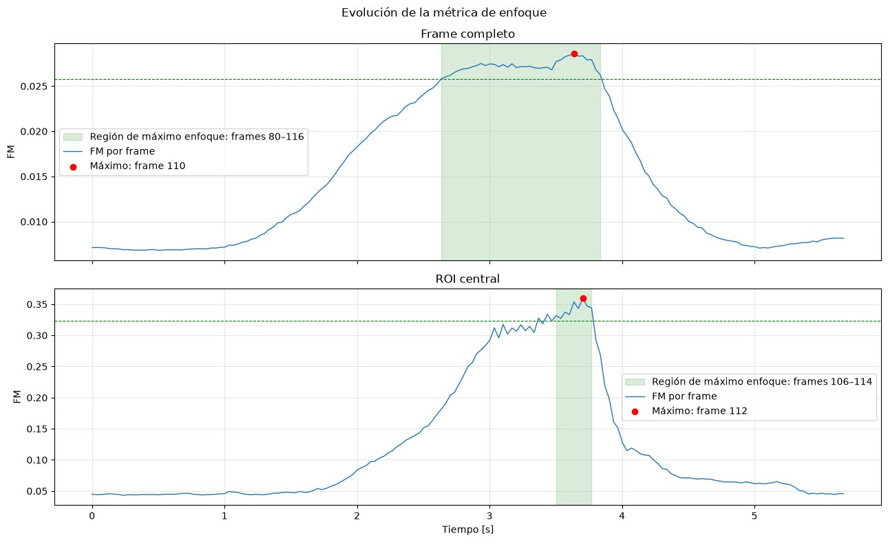
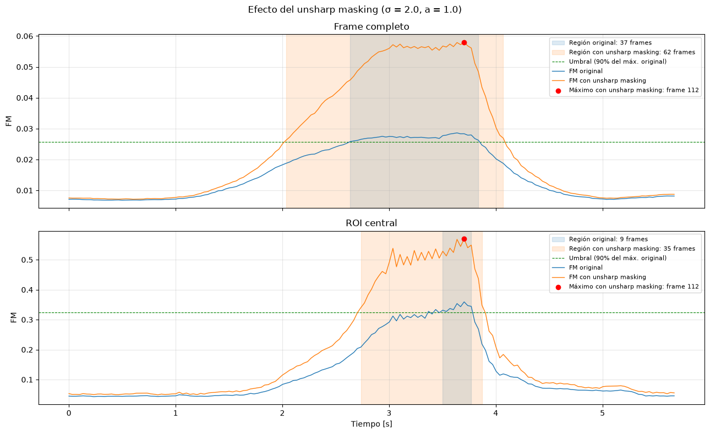
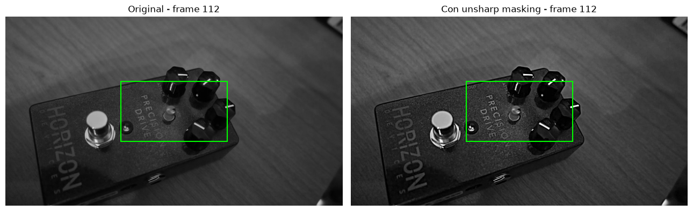

# TP2 – Detector de máximo enfoque

Visión por Computadora I – Especialización en Inteligencia Artificial (CEIA), FIUBA.

**Integrantes:** Hernando Alexis González, Victoria Villalba Tevez, Silvert Kevin Quispe Pacompia.

Notebook: [`TP2.ipynb`](TP2.ipynb)

## Consigna

Implementar un detector de máximo enfoque sobre un video aplicando técnicas de análisis espectral similar
al que utilizan las cámaras digitales modernas. El video a procesar es `focus_video.mov`.

1. Implementar un algoritmo que, dada una imagen o región, calcule la métrica propuesta en el paper
   *Image Sharpness Measure for Blurred Images in Frequency Domain* y realizar dos experimentos:
   1. Medición sobre todo el frame.
   2. Medición sobre una ROI ubicada en el centro del frame, con un área del 5 o 10% del área total.
2. Para cada experimento, presentar una o varias curvas con la evolución de la métrica frame a frame,
   donde se vea claramente cuándo el algoritmo detectó la región de máximo enfoque.
3. El algoritmo debe detectar y devolver los puntos de máximo enfoque de manera automática.

**Puntos extra:** aplicar *unsharp masking* para expandir la zona de enfoque.

## Método

### Métrica de enfoque (De y Masilamani, 2013)

Una imagen enfocada tiene bordes y texturas definidos, es decir, mucho contenido de **alta frecuencia**;
el desenfoque actúa como un filtro pasabajos y lo elimina. La métrica `FM` del paper cuantifica ese
contenido:

1. Se calcula la FFT 2D de la imagen en escala de grises y se centra (`fftshift`).
2. Se toma la magnitud del espectro y su valor máximo `M`.
3. Se cuentan los coeficientes con magnitud mayor que `M / 1000`.
4. `FM` = cantidad de coeficientes que superan el umbral / cantidad total de píxeles.

A mayor `FM`, más nítida es la imagen.

### Experimentos

- **Frame completo:** `FM` sobre cada frame entero (640 × 360 px).
- **ROI central:** `FM` sobre un rectángulo centrado de 202 × 114 px (9,99% del área del frame).

### Detección automática

Para cada curva el algoritmo devuelve:

- **Punto de máximo enfoque:** el frame con mayor `FM`.
- **Región de máximo enfoque:** el tramo continuo de frames alrededor del máximo con `FM` ≥ 90% del máximo.

## Resultados

Se procesaron 171 frames a 29,97 FPS (unos 5,7 s de video).

| Experimento | Frame máximo | Tiempo | FM máximo | Región de máximo enfoque |
|---|---|---|---|---|
| Frame completo | 110 | 3,637 s | 0,028624 | frames 80–116 (2,64–3,84 s, 37 frames) |
| ROI central | 112 | 3,704 s | 0,359389 | frames 106–114 (3,50–3,77 s, 9 frames) |



- Los dos experimentos ubican el máximo enfoque en el mismo momento, con una diferencia de solo 2 frames
  (unos 0,067 s).
- La curva del frame completo forma una meseta amplia, porque combina zonas de la escena que entran en foco
  en momentos distintos. La ROI responde solo al centro y da un pico más marcado y una región más angosta,
  contenida en la del frame completo.
- La ROI discrimina mejor el foco: su valor mínimo es alrededor del 12% de su máximo, contra el 24% en el
  frame completo.
- Los valores absolutos de `FM` de ambas curvas no son comparables entre sí, porque dependen del contenido
  de cada imagen. Lo que se compara es la ubicación del máximo y la forma de las curvas.

## Puntos extra: *unsharp masking*

El *unsharp masking* realza los detalles sumándole a la imagen la diferencia con una versión suavizada:

$$I_{\text{sharp}} = (1 + a)\,I - a\,(G_\sigma * I)$$

Se aplicó con σ = 2 y a = 1 a todos los frames, se recalculó `FM` y se contó cuántos frames superan el
**mismo umbral** que antes (90% del máximo de la curva original).

| Experimento | Región original | Región con *unsharp masking* | Frame máximo (original → filtrado) |
|---|---|---|---|
| Frame completo | frames 80–116 (37 frames) | frames 62–123 (62 frames) | 110 → 112 |
| ROI central | frames 106–114 (9 frames) | frames 83–117 (35 frames) | 112 → 112 |





- La zona de enfoque se expande 1,7 veces en el frame completo y casi 4 veces en la ROI, mientras que la
  posición del máximo prácticamente no cambia.
- El aumento de `FM` es mucho mayor cerca del foco que en los frames muy desenfocados, que casi no tienen
  detalle que realzar.
- La expansión es un efecto del realce digital, no una mejora óptica: el filtro no recupera la información
  perdida por el desenfoque, solo amplifica los bordes que quedan (y el ruido). Para decidir el foco conviene
  medir sobre la imagen original.

## Cómo ejecutarlo

Con el entorno del repositorio instalado (ver el [README principal](../README.md)):

```bash
cd TP02
jupyter nbconvert --to notebook --execute --inplace TP2.ipynb
```

o abrir `TP2.ipynb` en Jupyter / VS Code y ejecutar todas las celdas. El notebook lee el video desde
`Data/` con una ruta relativa, así que debe ejecutarse con `TP02/` como directorio de trabajo.

## Estructura

```
TP02/
├── README.md
├── TP2.ipynb            # notebook con código, salidas y análisis
├── Data/
│   └── focus_video.mov  # copia de Material_TPs/TP2 de la cátedra
└── figuras/             # figuras exportadas del notebook para este README
```

## Referencias

- K. De y V. Masilamani, *Image Sharpness Measure for Blurred Images in Frequency Domain*, Procedia
  Engineering 64 (2013) 149–158.
- Material de la cátedra:
  [`Material_TPs/TP2`](https://github.com/FIUBA-Posgrado-Inteligencia-Artificial/vision_computadora_I/tree/main/Material_TPs/TP2)
  y diapositivas de la Clase 3.
